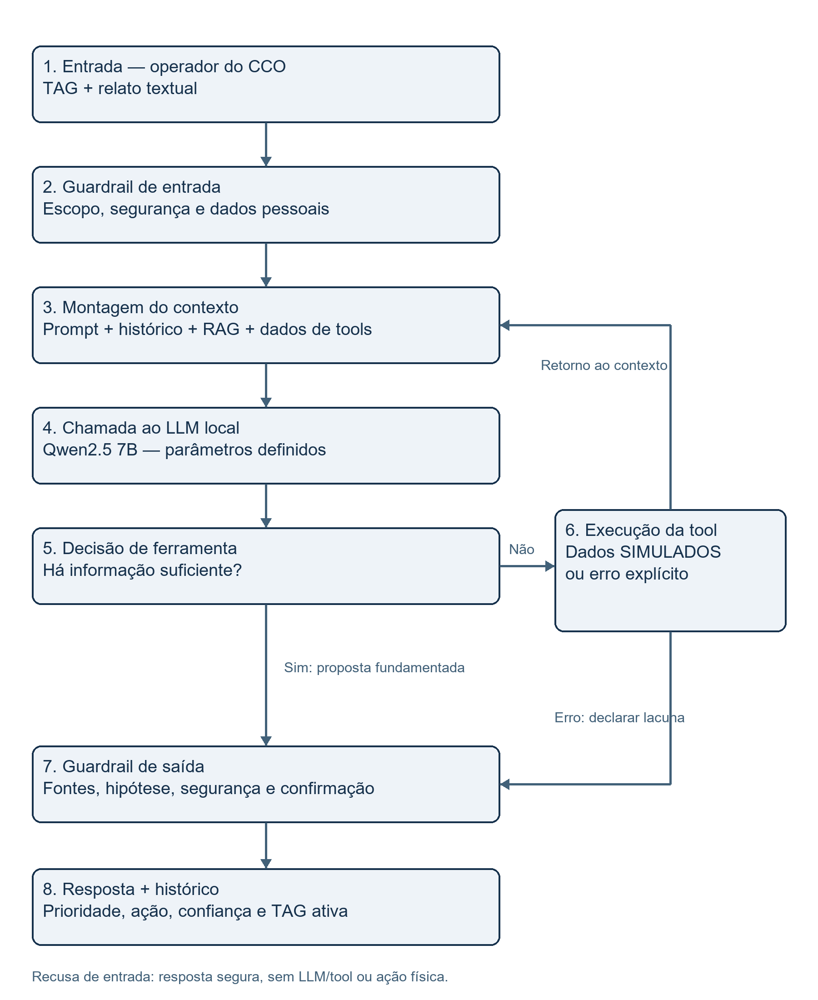

# EngMan Copilot — CCO Câmeras

**Projeto acadêmico — FIAP × Motiva Rodovias — Sprint 01 (documentação).**

> Situação: documentos propostos e organizados; não foi desenvolvido nem executado o assistente, as ferramentas, o RAG ou qualquer integração com a Motiva. O conjunto de testes é uma especificação, não resultados de testes. Todos os dados operacionais de exemplo são **SIMULADOS**.

**Grupo:** 4 (confirmar no cadastro oficial). **Turma:** CCP A (confirmar a grafia oficial por integrante). **Recorte:** B — Operação e Priorização de Campo. **Persona principal:** operador do CCO.

**Integrantes (conferir grafia e turma antes do envio):**

* Kalil Bachur — RM 576335 — CCP A
* Isadora Couto — RM 576852 — CCP A
* Letticia Aparecida Martins — RM 575441 — CCP A
* Gustavo Valentim de Souza — RM 575916 — CCP A
* Ohana Soares — RM 574691 — CCP A

**Nome usado nesta entrega:** EngMan Copilot — CCO Câmeras. O projeto original é "Câmeras autolimpantes de classificação veicular". A Sprint atual cobre somente triagem textual de falhas visuais CFTV, não classificação de veículos nem limpeza física.

## 1. Problema abordado

O enunciado do Challenge descreve câmeras de CFTV em campo com lente suja, teias, ninhos, desfoco e imagem degradada, além de falsos positivos associados a chuva, neblina e reflexo solar. A percepção humana no CCO e a manutenção reativa dificultam a identificação precoce e a priorização das intervenções. O próprio documento informa atuação da Motiva em 13 estados, com 37 ativos, mais de 16 mil colaboradores e mais de 5 mil quilômetros de rodovias concedidas. Esses números são contexto do enunciado fornecido, não estatísticas atuais verificadas nem resultados deste projeto.

O PDF do grupo propõe preservar a qualidade das imagens com identificação de obstruções e mecanismos de limpeza, além de classificar veículos e eixos. Para esta Sprint, a documentação se concentra na camada conversacional de apoio à operação: diante de relatos e alertas textuais sobre uma câmera, o assistente consulta dados disponíveis, distingue evidências de hipóteses, classifica a ocorrência e recomenda prioridade e encaminhamento de manutenção. Não promete reconhecer objetos em imagens nem controlar hardware nesta fase.

A dor escolhida é a triagem de problemas de visibilidade das câmeras, aderente ao Tema 2.1 — Saúde visual dos ativos ITS. A classificação de veículos conecta a visão futura ao Tema 1, mas não amplia o escopo do assistente para cálculo de tarifa ou decisão de cobrança.

## 2. Recorte e persona

O recorte B é adequado porque o operador do CCO recebe alarmes e precisa decidir o que monitorar, o que investigar e o que encaminhar para manutenção. A resposta deve indicar classificação, prioridade, evidências, incertezas e ação recomendada. O erro central é ignorar uma falha relevante ou provocar deslocamento desnecessário com um falso positivo ambiental.

Persona principal: operador do CCO que trabalha com relatos de ocorrências de câmeras e precisa justificar uma decisão operacional. Não pressupomos idade, escala de trabalho, certificações ou dados pessoais. O coordenador de manutenção é apenas o destinatário do encaminhamento e da validação das propostas de OS, não uma segunda persona principal.

## 3. Escopo do assistente

## O que faz

* Atende ocorrências de perda de visibilidade e qualidade de imagem de câmeras CFTV dentro do catálogo disponível.
* Consulta cadastro por TAG e histórico de falhas da mesma TAG.
* Consulta procedimentos de inspeção e manutenção documentados.
* Classifica relatos como falha/obstrução provável, condição ambiental provável ou indeterminado, sem apresentar hipótese como diagnóstico confirmado.
* Recomenda prioridade com critérios documentados de segurança, disponibilidade e impacto operacional.
* Redige proposta de OS e resumo de atendimento; uma abertura é apenas simulada, após confirmação explícita e retorno de ferramenta.
* Declara dados ausentes, divergências entre fontes e necessidade de validação humana.

## O que não faz

* Não aciona limpador, servo, jato de ar, microcontrolador ou outro atuador.
* Não libera, bloqueia ou interfere fisicamente em equipamento, pista ou sistema de cobrança.
* Não classifica veículos/eixos nem decide tarifas; essas funções pertencem à evolução futura do sistema original.
* Não identifica pessoas, placas ou ocupantes; não processa imagens pessoais nem dados reais de arrecadação.
* Não emite laudo, ART, parecer com validade legal ou autorização de trabalho.
* Não substitui POP, NR-10, NR-35, análise de risco ou profissional habilitado.
* Não inventa TAG, modelo, periodicidade, métrica, número de OS ou histórico.
* Não atende outros ativos ou temas alheios ao recorte, nem considera uma câmera cadastrada como prova de integração ao pedágio.

## Evolução futura, sem promessa nesta Sprint

O projeto original prevê visão computacional para obstruções e classificação veicular, limpeza física segura, verificação antes/depois e uma maquete rodoviária com carrinho. OpenCV é biblioteca de visão computacional; MediaPipe oferece componentes de percepção e não substitui um protocolo de comunicação com Arduino. A interface com ESP32/Arduino dependeria de protocolo e biblioteca apropriados, a definir. AWS e Google Sheets aparecem no PDF como ideias, mas não são dependências desta documentação: nenhum serviço pago ou integração não especificada é necessário para a proposta local gratuita.

## 4. Arquitetura da solução

Figura 1. Arquitetura conceitual: oito blocos e ciclo de ferramentas; sem execução nesta Sprint.

O assistente recebe texto, não imagens. Relatos sobre sujeira ou animais são observações informadas pelo usuário, não detecções comprovadas pelo assistente.

1. Entrada: operador envia pergunta ou ocorrência com TAG, sintoma, horário, persistência, condição ambiental e impacto conhecido. Campos ausentes são solicitados, não inferidos.
2. Guardrail de entrada: verifica escopo, conteúdo hostil, risco operacional e dados pessoais. Recusa pedidos perigosos e não aceita instruções embutidas em documentos como novas regras.
3. Montagem do contexto: reúne system prompt, TAG ativa, histórico limitado, trechos RAG com fontes e resultados das ferramentas. Não insere toda a base de conhecimento.
4. Chamada ao LLM: modelo local recebe contexto e contratos de ferramentas; produz proposta fundamentada ou solicitação de ferramenta, sem executar ações físicas.
5. Decisão de tool: se faltar cadastro, histórico ou procedimento, solicita a consulta apropriada. Uma proposta de OS só vira abertura simulada após confirmação dos campos e autorização explícita.
6. Execução da tool: camada determinística valida parâmetros e permissões, retorna dados simulados e reinjeta o resultado no bloco 3. Erro ou resultado vazio não vira dado inventado. Limite proposto de três chamadas de ferramentas por turno, sem repetição automática de abertura incerta.
7. Guardrail de saída: verifica TAG, fonte, distinção entre fato e hipótese, regra de prioridade, segurança, confirmação de OS e ausência de dados pessoais. Se falhar, revisa uma vez ou entrega aviso de impossibilidade; não libera resposta insegura.
8. Resposta e histórico: devolve classificação, prioridade, evidências, ação e confiança qualitativa; guarda resumo minimizado e TAG ativa. Não altera OS real nem sistema rodoviário.

Fluxo principal: entrada → guardrail de entrada → contexto → LLM → decisão de tool. Sem necessidade de consulta, segue ao guardrail de saída e à resposta. Havendo consulta, passa pela execução e retorna ao contexto. Recusas de entrada seguem diretamente à resposta segura. O fluxograma em `docs/arquitetura.png` representa esse fluxo e está referenciado acima.

Por que IA generativa: relatos livres, consultas a procedimentos e redação de OS exigem interpretação e síntese de linguagem. Cadastro, critérios de prioridade, permissões e validação de parâmetros permanecem determinísticos. Um modelo não substitui regras de segurança nem a validação humana.

## 5. Stack e justificativa técnica

Recomendação de projeto, sem benchmark executado: Ollama local + Qwen2.5 7B + Chroma local + embeddings locais Sentence Transformers + chamada direta via SDK Python. Não depende de chave paga. Energia, armazenamento e computador têm custo; ausência de cobrança por token não significa infraestrutura gratuita.

## Comparação de modelos

Qwen2.5 7B, distribuição Ollama qwen2.5:7b: Apache 2.0 para esta variante; pacote Q4_K_M publicado de aproximadamente 4,7 GB; suporte declarado a português e saídas estruturadas. O metadado do pacote consultado informa contexto de 32.768 tokens, embora a família anuncie até 128 mil. Não presumir extensão automática. Integração por SDK Python; funcionamento local sem enviar consultas a provedor externo. Qualidade operacional em português será medida pelo eval set, não foi comprovada aqui.

Llama 3.1 8B, distribuição Ollama llama3.1:8b: Llama 3.1 Community License, com condições próprias; pacote Q4_K_M publicado de aproximadamente 4,9 GB; família anuncia contexto de 128 mil e capacidades multilíngues e de ferramentas. SDK Python e execução local. O contexto efetivamente configurado e o consumo de memória devem ser verificados no ambiente; o tamanho do download não é a RAM necessária. Não há resultado comparativo do grupo.

Trade-off: recomendar Qwen2.5 7B pela licença Apache 2.0, suporte declarado a português e foco declarado em saída estruturada, aceitando menor contexto publicado nesta distribuição. Manter Llama como alternativa de avaliação. A escolha final deve registrar versão, configuração, latência e resultados por categoria. Não são apresentados como modelos mais recentes ou superiores em todos os cenários.

## Comparação de vector stores

Chroma local: Apache 2.0; biblioteca com persistência local e filtros de metadados em consultas. Favorece recuperação filtrada por tipo de ativo, documento e versão. Integração Python e documentação própria. Exige cuidado com versões, backup, acesso ao diretório e manutenção do índice; modo local não implica segurança automática.

FAISS: MIT; biblioteca C++ com interfaces Python para busca e agrupamento de vetores, com armazenamento de índices em disco. Metadados, documentos e regras de filtragem de domínio demandam camada adicional; não é, sozinho, um banco documental completo. Boa alternativa para índice local simples, mas exige mais composição do pipeline.

Trade-off: Chroma recomendado para simplificar a associação entre trechos, fontes e filtros. FAISS reduz a dependência de um banco vetorial completo, porém aumenta a responsabilidade por sincronizar índice, documentos e metadados. Ambos têm execução local sem tarifa obrigatória por consulta.

## Parâmetros e componentes

Temperatura proposta: 0,1, para reduzir variação; isso não elimina alucinações. Contexto configurado inicial: 8.192 tokens. Limite de saída: 800 tokens (max_tokens como conceito; mapear para num_predict no Ollama). Não aceitar número de confiança probabilística inventado. Orquestração: SDK direto, escolhido para manter o ciclo de ferramentas explícito; LangChain seria alternativa, com maior abstração e dependência. Ambiente futuro: Python 3.10 ou superior em VS Code, Git e GitHub. Interface futura opcional: terminal ou Streamlit local. Não há código a entregar nesta Sprint.

Embeddings propostos: sentence-transformers/paraphrase-multilingual-MiniLM-L12-v2, vetores de 384 dimensões. A configuração publicada possui max_seq_length de 128 tokens. Dividir em unidades semânticas com alvo de 80 a 100 tokens do tokenizer desse modelo, teto total de 128 incluindo tokens especiais e sobreposição aproximada de 15. POPs maiores devem ser subdivididos sem omitir os pré-requisitos de segurança, preservados por referência e recuperados junto da etapa. Não tratar esse limite como tokens do LLM, pois são tokenizadores diferentes.

Política de contexto proposta: system prompt e contratos até 3.000 tokens; resumo e últimas quatro mensagens até 1.000; no máximo seis trechos recuperados, limitados a 1.200 tokens do LLM; resultados de ferramentas e pergunta até 1.200; reserva de saída de 800 e margem de 992, total de 8.192. São tetos de projeto, não medições do documento atual. Contar com o tokenizer efetivo antes de executar; se exceder, reduzir histórico/trechos, nunca regras de segurança. Se o prompt sozinho exceder o teto, compactá-lo com revisão dos testes ou elevar o contexto dentro da capacidade disponível. A cada seis turnos, gerar resumo com TAG, fatos, hipóteses e pendências; na troca de TAG, separar claramente os casos.

### Comparação de modelos

|Critério|Qwen2.5 7B|Llama 3.1 8B|
|-|-|-|
|Custo de uso local|Sem tarifa obrigatória por token; infraestrutura tem custo|Sem tarifa obrigatória por token; infraestrutura tem custo|
|Licença/termos|Apache 2.0 para variante 7B|Llama 3.1 Community License; condições próprias|
|Português|Suporte declarado; qualidade no eval set ainda não medida|Multilíngue; qualidade no eval set ainda não medida|
|Contexto|Pacote consultado: 32.768; família anuncia até 128 mil|Família anuncia 128 mil; contexto efetivo depende da configuração|
|Distribuição consultada|Ollama Q4_K_M, cerca de 4,7 GB|Ollama Q4_K_M, cerca de 4,9 GB|
|Privacidade/Python|Local + SDK; controlar logs/acesso|Local + SDK; controlar logs/acesso|
|Documentação e escolha|Documentação pública; recomendado, sem benchmark local|Documentação pública; alternativa comparativa|
|Trade-off|Licença permissiva/saída estruturada versus contexto do pacote|Outra família/maior contexto anunciado versus licença própria|

### Comparação de vector stores

|Critério|Chroma local|FAISS|
|-|-|-|
|Custo/licença|Execução local; Apache 2.0|Execução local; MIT|
|Armazenamento|Documentos, vetores e metadados com persistência local|Índice vetorial; documentos/metadados em camada adicional|
|Filtro de domínio|Filtros de metadados na consulta|Exige composição com camada de domínio/metadados|
|Português/contexto|Dependem dos embeddings/LLM; não gera resposta|Dependem dos embeddings/LLM; não gera resposta|
|Python e documentação|API Python; documentação de coleções e filtros|Interfaces Python; documentação de algoritmos/índices|
|Privacidade|Local; controlar acesso, versões e backup|Local; controlar índice e armazenamento complementar|
|Trade-off|Recomendado pela menor composição do pipeline|Alternativa por flexibilidade; maior responsabilidade de integração|

## 6. Base de conhecimento e RAG

Inventário com 10 categorias de documentos, origem, status, política de chunking, filtros e exclusões de dados pessoais: [inventario.md](data/knowledge_base/inventario.md). O catálogo de 30+ ativos e o histórico de 50+ falhas são **planejados**, não foram apresentados como completos. Há massa SIMULADA pequena para exemplificar testes.

## 7. System prompt

Texto completo em [system_prompt.md](prompts/system_prompt.md): papel, objetivo, escopo, regras, formato, tom e borda, incluindo recusa, níveis de confiança, few-shot, conflitos de fonte e casos sem dados.

## 8. Eval set

[14 casos estruturados em JSON](evals/sprint1_eval_set.json), nas oito categorias do professor: factual (C01, C02 e C14), instrucional (C03, C04 e C13), ambíguo (C05), dado_inexistente (C06), out_of_scope (C07), jailbreak (C08, C09), risco_operacional (C10, C11) e memoria_contexto (C12). **Casos não executados**; `resposta_ideal` é critério esperado e não resultado medido.

## 9. Tools especificadas

Contratos completos em [tools_spec.json](tools/tools_spec.json): `consultar_ativo`, `consultar_historico_falhas`, `consultar_procedimento` e `abrir_ordem_servico`. Os schemas descrevem uma possível implementação futura, **não executam nenhuma função**. Qualquer OS é SIMULADA e depende de confirmação humana e recibo válido.

## 10. Riscos, ética e LGPD

Matriz de riscos com mitigação e rastreabilidade em [riscos_lgpd.md](docs/riscos_lgpd.md). Não incluir rostos, placas reais, dados de funcionários, credenciais ou informações operacionais confidenciais.

## 11. Limitações conhecidas

* Não existe protótipo nesta entrega. Nenhuma acurácia, economia, taxa de falha ou latência foi medida.
* Não foram recebidos cadastro, FSM, POPs internos, fichas reais ou regras tarifárias da Motiva.
* O inventário especifica a base; a pequena massa de teste não equivale às 30 linhas/50 registros planejados.
* Critérios de P1/P2/P3 são simulados e devem ser validados antes de qualquer uso real.
* A stack local exige computador compatível; não foram informados RAM/GPU ou ambiente do grupo. A viabilidade no equipamento disponível precisa ser testada na fase de implementação.
* O assistente processa texto; não comprova presença de sujeira, teia, veículo ou ninho. A integração com visão computacional e hardware é futura.
* O nome utilizado nesta entrega é EngMan Copilot — CCO Câmeras. Grupo 4, turma CCP A, nomes e RMs dos cinco integrantes estão preenchidos; a atribuição de responsabilidades permanece pendente de confirmação pelo grupo.
* Os artefatos estão organizados nos caminhos indicados; após publicá-los, é necessário conferir os links e a exibição dos arquivos no GitHub.

## 12. Referências

Fontes primárias recebidas:

* Doze imagens do documento “Challenge Integrador — Sprints 01 e 02 de 04 / EngMan Copilot”, FIAP × Motiva, Prof. Jorge Luiz Gomes. O rodapé informa semestre 2026.2 e referência ao briefing de 16/09/2026. As imagens foram lidas; o briefing original citado não foi recebido.
* PDF “Câmeras autolimpantes de classificação veicular”, nove páginas, fornecido pelo usuário. Fonte da ideia, componentes futuros, limitações e maquete; não apresenta validação experimental.
* Confirmações do usuário nesta sessão: aprovação da ideia pelo professor, recorte B e persona operador do CCO. A aprovação é informação do usuário, não registro independente do professor.

Referências técnicas consultadas em 10/11/2026:

* Ollama — Qwen2.5 7B: https://ollama.com/library/qwen2.5:7b
* Metadados do pacote Qwen2.5 7B: https://ollama.com/library/qwen2.5:7b/blobs/2bada8a74506
* Ollama — Llama 3.1 8B: https://ollama.com/library/llama3.1:8b
* Chroma — filtros: https://docs.trychroma.com/docs/querying-collections/metadata-filtering
* Chroma — licença: https://github.com/chroma-core/chroma/blob/main/LICENSE
* FAISS — documentação: https://faiss.ai/
* FAISS — licença: https://github.com/facebookresearch/faiss/blob/main/LICENSE
* Sentence Transformers — configuração do embedding: https://huggingface.co/sentence-transformers/paraphrase-multilingual-MiniLM-L12-v2

Referências oficiais de segurança e proteção de dados localizadas para consulta da versão aplicável; não foram transcritos artigos ou procedimentos normativos completos:

* Ministério do Trabalho e Emprego — Normas Regulamentadoras Vigentes, incluindo NR-10 e NR-35: https://www.gov.br/trabalho-e-emprego/pt-br/acesso-a-informacao/participacao-social/conselhos-e-orgaos-colegiados/comissao-tripartite-partitaria-permanente/normas-regulamentadora/normas-regulamentadoras-vigentes
* Governo Federal — LGPD, Lei 13.709/2018: https://www.gov.br/pt-br/lgpd/lei-no-13-709-18-lei-geral-de-protecao-de-dados-lgpd-1

Não foram consultados preços de componentes, regras de tarifa, normas internas da Motiva ou resultados de testes do grupo. As recomendações técnicas e exemplos sintéticos foram elaborados com apoio do G4 OS e devem ser revisados pelos integrantes. A participação da IA não substitui autoria responsável, validação do conteúdo e contribuição real no repositório.

## 13. Organização do repositório

Arquivos: `README.md`, `.gitignore`, `docs/arquitetura.png`, `docs/riscos_lgpd.md`, `prompts/system_prompt.md`, `evals/sprint1_eval_set.json`, `data/knowledge_base/inventario.md`, `tools/tools_spec.json` e `sprint1_entrega.txt`. A seção de decisões técnicas fica neste README (arquivo adicional é opcional).

